

  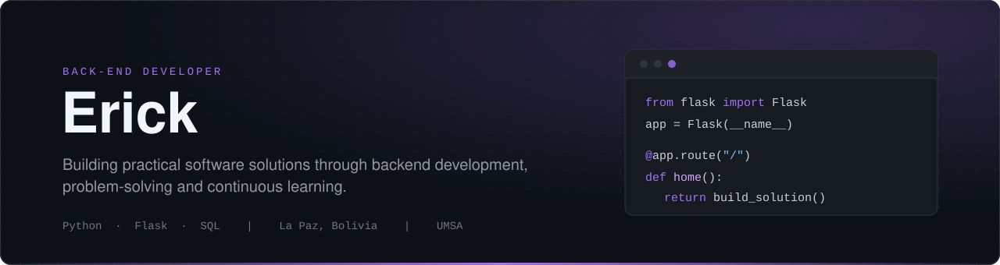

I'm **Erick**, a Back-End developer from La Paz, Bolivia. I build web applications and management systems that solve practical problems, mainly with **Python, Flask and SQL**. I'm currently studying Computer Science with a specialization in Software Development and Technological Innovation at UMSA.

## About Me

| | |
|:--|:--|
| **Focus** | Back-End development, web applications and management systems |
| **Based in** | La Paz, Bolivia |
| **Studying** | Computer Science, specializing in Software Development and Technological Innovation, UMSA (8th semester) |
| **Main stack** | Python · Flask · SQL |
| **Also work with** | PostgreSQL · Java · Spring Boot · PHP · Laravel |
| **Approach** | Practical, efficient and maintainable solutions |

I work independently, building tools that replace manual work and improve administrative processes. My projects include community management and administrative systems.

I'm also comfortable with Excel, Word and other productivity tools, and I'm using my studies and projects to keep growing in software engineering.

## Tech Stack

**Backend & Programming**

  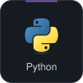
  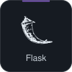
  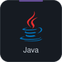
  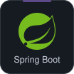
  
  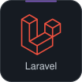

**Databases**

  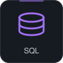
  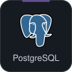
  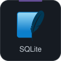

**Tools & Development**

  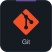
  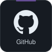
  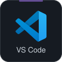
  

Also: data analysis, machine learning fundamentals, Excel and Word.

## Featured Projects

### Community Management System

| | |
|:--|:--|
| **What it is** | A Flask web application to manage the registry of a neighborhood association of around 900 people: owners, land plots, meetings, attendance, fees and fines. |
| **Problem** | Administrative information had to be managed in an organized and reliable way. |
| **Solution** | A database-backed system with role-based users, Excel-exportable reports and printable account statements. |
| **Stack** | Python · Flask · SQLAlchemy · SQL |
| **Repository** | [Erickxdps/sistema-registro-catastro](https://github.com/Erickxdps/sistema-registro-catastro) |

### Museum of Natural History: Ticketing System

| | |
|:--|:--|
| **What it is** | A web application to sell tickets, register entries and close the daily cash register of a museum. |
| **Problem** | Entries were handled through manual procedures that were hard to control. |
| **Solution** | QR tickets and numbered physical booklets by visitor category, QR validation from a phone over the local network, and daily reports with better administrative control. |
| **Stack** | Python · Flask · SQLite |
| **Repository** | [Erickxdps/mhn-ticketing](https://github.com/Erickxdps/mhn-ticketing) |

### Café Manager

| | |
|:--|:--|
| **What it is** | An offline-first management app for a coffee shop: orders, payments, inventory, cash register, daily closing, recipes and reports. |
| **Solution** | A Flask + SQLite back-end that runs locally, built in stages from a master specification. |
| **Stack** | Python · Flask · SQLite |
| **Repository** | [Erickxdps/cafe-manager](https://github.com/Erickxdps/cafe-manager) |

### Academic & API Projects

| Repository | Description |
|:--|:--|
| [hospital-api](https://github.com/Erickxdps/hospital-api) | REST API in Python for a hospital domain. |
| [store-api](https://github.com/Erickxdps/store-api) | REST API in Python for a store domain. |
| [INF-133](https://github.com/Erickxdps/INF-133) | Web programming coursework in Python. |
| [Practica1](https://github.com/Erickxdps/Practica1) | Java coursework (TAW). |

## Currently Learning & Interests

- **Back-End development:** writing cleaner, more maintainable applications.
- **Databases:** data modeling and systems that stay consistent as they grow.
- **Automation:** replacing repetitive manual processes with reliable software.
- **Machine learning:** applying data analysis and ML to practical problems.
- **Software engineering:** architecture, testing and good development practices.

## Connect With Me

- **GitHub:** [github.com/Erickxdps](https://github.com/Erickxdps)
<!-- TODO: add LinkedIn when available:
- **LinkedIn:** [linkedin.com/in/YOUR-USER](https://www.linkedin.com/in/YOUR-USER) -->

  Building practical software solutions through backend development, problem-solving and continuous learning.

